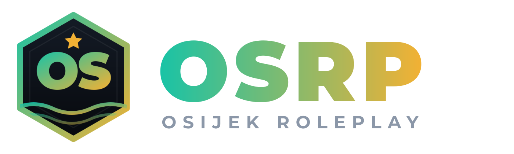
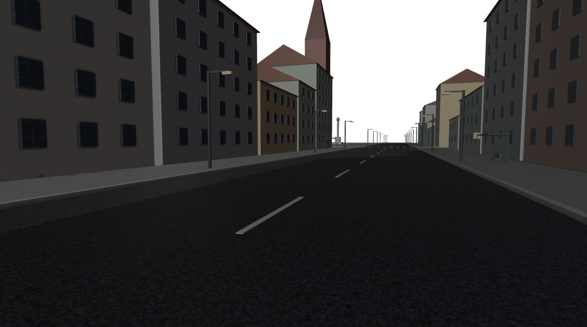
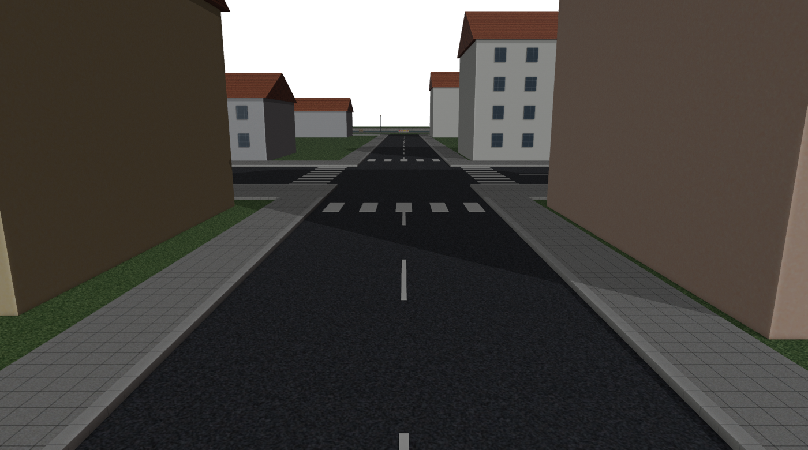

<p align="center"></p>

# OSRP Launcher — V1

A free launcher for **OSRP (Osijek Roleplay)**, a GTA V server (it runs on FiveM).
It uses the player's **own installed GTA V** (`GTA5.exe`). Players have to own a legal copy of the game.

> **Version:** 1.0.9 (V1). Stays at V1 until V2 is approved.

## What V1 does

- **Its own startup loading window** (OSRP logo + real checks: settings, finding GTA V, server status)
- **OSRP logo** everywhere: app icon, installer, title bar, sidebar, in-game loading screen
- **Own OSRP accounts**: players register and log in with an OSRP username and password, stored on your own server (`osrp_accounts`)
- **Ownership check**: the player has to confirm they own GTA V before going further
- **Store links** for players without the game: Steam, Epic Games, Rockstar
- **Finds GTA V automatically** (registry, Steam libraries, common folders), or the player can pick `GTA5.exe` by hand
- Checks that the file really is `GTA5.exe` / `GTA5_Enhanced.exe`
- **PLAY** installs the multiplayer client by itself (one time, after the player accepts the Cfx.re license) and connects straight to OSRP. Players never have to visit fivem.net
- **Singleplayer** starts GTA V through Steam, Epic or the Rockstar Launcher
- Shows whether the server is online and how many players are on
- News cards and a Discord link (set in `launcher/config.json`)

## Folders

```
launcher/              Electron app (Windows)
  config.json          server IP, Discord, news  <- edit this
  main.js              game detection + launching
  renderer/            UI (HTML/CSS/JS)
fivem-resources/
  osrp_core/           map name "Osijek", OSRP pause menu, keeps the GTA V HUD, stream/ for your map
  osrp_loading/        in-game loading screen with the OSRP logo
  osrp_framework/      own roleplay framework (characters, money, jobs, /me /do, admin)
  osrp_accounts/       own account system for the launcher (register / login)
  osrp_map/            in-game map builder with real GTA V props (street lights, trees, benches)
  osrp_osijek/         the custom Osijek city in-game (35 chunks, placed in the sea east of Los Santos, /osijek)
server/                setup-server.bat + start-server.bat (own test server on your PC)
branding/              OSRP logo (svg + png)
.github/workflows/     builds the .exe automatically on GitHub
```

## Start your own OSRP test server (Windows, free)
1. Download this repo (green **Code** button → *Download ZIP*) and unzip it.
2. Open the `server` folder and double-click **`setup-server.bat`**. It:
   - downloads the official server (FXServer) and the base resources
   - copies all OSRP resources into the server
   - asks for your **free server key** from [portal.cfx.re](https://portal.cfx.re) (Server Keys → Generate; use `127.0.0.1` for testing)
3. Double-click **`start-server.bat`**. Wait until the console shows the server started.
4. In the **OSRP Launcher**, go to *Postavke → Server adresa*, enter `127.0.0.1:30120`, *Spremi*, then **IGRAJ**.
5. The first time you join, the console prints an `add_principal ...` line with your license. Paste it into `server/OSRP-Server/server-data/server.cfg` and restart the server. That makes you admin.

Friends can join through the launcher with your public IP (`your.ip:30120`) once you open **port 30120 (TCP + UDP)** on your router and allow it in the Windows firewall.

## Keep OSRP online 24/7

### Option A: your own PC (free)
- `start-server.bat` restarts the server by itself if it ever crashes.
- Run **`install-autostart.bat`** once and the server starts automatically every time Windows starts (`remove-autostart.bat` turns that off).
- It's only online while your PC is on. In Windows power settings, set *Sleep → Never*.
- Friends join via your public IP: open **port 30120 TCP + UDP** on your router.

### Option B: Linux VPS (real 24/7, the PC can be off)
Needs an **x86_64 (Intel/AMD)** VPS with Ubuntu 22.04/24.04 or Debian 12, 4 GB RAM or more.
ARM servers (like the Oracle free tier) **don't work**, because FXServer only runs on x86_64.

Connect to the VPS over SSH and run **one command**:
```bash
curl -fsSL https://raw.githubusercontent.com/jakov543/Osrp/main/server/linux/install-osrp.sh | sudo bash
```
It installs everything, asks for your Cfx.re key, and sets OSRP up as a system service: it **starts on boot and restarts itself if it crashes**. At the end it prints the address to enter in the launcher.

| | Command |
|---|---|
| Console / logs | `journalctl -u osrp -f` |
| Restart | `sudo systemctl restart osrp` |
| Update OSRP from GitHub | `sudo bash /opt/osrp/repo/server/linux/install-osrp.sh update` |

## OSRP framework (own, no ESX/QBCore)
| What | How |
|---|---|
| Character creator | first join: first name, last name, date of birth, gender |
| Spawn / save | spawn point in `osrp_framework/config.lua`; position saved every 60 s |
| Money | cash + bank, HUD at top right, `/novac`, `/daj [id] [amount]` |
| Jobs + salary | Unemployed, Police, EMS, Mechanic, Taxi; pay every 10 min |
| Death | respawn at the hospital after 15 s (`E`) |
| Roleplay | `/me`, `/do` (3D text + chat, players nearby only) |
| Admin | `/car [model]`, `/dv`, `/tpm`, `/revive [id]`, `/setjob [id] [job]`, `/givemoney [id] [cash/bank] [amount]`, `/resetlik [id]` |

For other scripts: `exports.osrp_framework:GetPlayer(src)`, `AddMoney(src, 'cash', 100)`, `RemoveMoney(...)`, `SetJob(src, 'police')`.
No database needed for V1 (data is stored with FiveM KVP).

## Setup

### 1. Server
Easiest: use `server/setup-server.bat` (above). By hand: copy `fivem-resources/osrp_core`, `osrp_loading` and `osrp_framework` into your server's `resources/` folder and add to `server.cfg`:
```
ensure osrp_loading
ensure osrp_core
ensure osrp_framework
ensure osrp_accounts
ensure osrp_map
sets mapname "Osijek"
```

### 2. Launcher
Set your server IP in `launcher/config.json`:
```json
"serverAddress": "YOUR.IP:30120"
```

Run it locally:
```
cd launcher
npm install
npm start
```

Build the installer (.exe):
```
npm run dist
```
The installer ends up in `launcher/dist/`.

### 3. GitHub (free)
```
git remote add origin https://github.com/jakov543/Osrp.git
git push -u origin main
git tag v1.0.9
git push origin v1.0.9
```
GitHub Actions builds the Windows installer and puts it on the **Releases** page.

## OSRP accounts (own login)
- The `osrp_accounts` resource runs on your FiveM server. The launcher talks to it at `http://SERVER_IP:30120/osrp_accounts/...`.
- Register / log in in the launcher. The login is remembered for 30 days.
- Passwords are stored hashed (scrypt + salt), never as plain text. Brute-force protection: 8 wrong tries means a 10-minute wait, and at most 3 new accounts per IP per hour.
- Add `ensure osrp_accounts` to `server.cfg` (already in the template).
- Note: the connection to the server is plain HTTP, so tell players not to reuse a password from other sites.

## Build the city in-game with GTA V props (`osrp_map`)
Admins place real GTA V props in-game. Everything is saved on the server and everyone sees it. GTA street lights light up at night by themselves.

| Command | What it does |
|---|---|
| `/prop lampa` | street light in front of you (`lampa2` = modern) |
| `/prop drvo` | random leafy tree (birch, maple, oak). `bor` = pine, `grm` = bush |
| `/prop klupa` / `/prop kanta` | bench / bin |
| `/prop prop_bench_09` | **any** GTA V prop by its name |
| `/proplinija lampa 10 25 2` | a row: 10 lamps, every 25 m, **on both sides** of where you face (a whole street in one command) |
| `/proplinija drvo 15 12` | an alley of 15 trees, every 12 m |
| **`/predlozak ulica 120 14`** | **a whole street**: stand in the MIDDLE of the road and look along it. Lamps on both sides, tree alley, benches, bins, bollards, a hydrant (120 m long, road 14 m wide) |
| **`/predlozak trg 18`** | **a square**: stand in the center. Fountain, ring of trees, benches facing the center, lamps, bushes |
| **`/predlozak park 40 60`** | **a park** 40×60 m: stand at the start of the path. Path lamps, benches, rows of trees, bushes |
| **`/predlozak promenada 150`** | **a promenade**: props on your LEFT (e.g. along water). Lamps, trees, benches |
| `/propobrisi` | delete the nearest placed prop (within 5 m) |
| `/propundo` | delete the last placed prop |
| `/propovi` | list of short names |

Short names are in `osrp_map/config.lua` and you can add your own. Props only appear within 250 m, so FPS stays high.

## The real Osijek in-game (`osrp_osijek`)
`map/blender/osijek_export_gta.py` converts the Blender city with **Sollumz** into GTA assets:
- 35 chunks of 100 m, each a drawable with embedded textures and collision
- `osijek.ytyp` with all archetypes

On Linux it writes CodeWalker XML. On Windows, with Sollumz plus PyMateria, it writes the native `.ydr` / `.ytyp` files directly.

**The finished files are already in `osrp_osijek/stream/`.** v1.0.9 has 36 models with real textures (asphalt, paving, grass, brick, roof tiles, plaster, water, stone, gravel, glass, wood), per-surface collision (tarmac, concrete paving, grass, gravel, brick, roof tile...), intersections open for cars, and 109 real GTA V trees placed by script. Converted with `tools/xml2gta` (CodeWalker.Core) and verified.
Add `ensure osrp_osijek`. Players spawn in Osijek (`osrp_framework/config.lua`), and admins can use `/osijek` to teleport there.

## Osijek map in Blender
Starter city script and full guide: [`map/BLENDER-MAP.md`](map/BLENDER-MAP.md)


| Street | Night |
|---|---|
|  |  |

| Intersection | Tvrđa (Holy Trinity column) |
|---|---|
|  |  |

## Requirements for players
- Windows 10/11
- A legal copy of GTA V (Steam / Epic / Rockstar)
- Nothing else: the launcher installs the multiplayer client by itself

## Osijek map
`osrp_core` renames the map to **Osijek** (server list, pause menu, map labels).
To build actual Osijek streets and buildings, put `.ymap/.ydr/.ytd` files in `osrp_core/stream/`.
Free tools for that: **CodeWalker** and **Blender + Sollumz**.

## Legal
This project is not affiliated with Rockstar Games or Take-Two. GTA V is not included. Every player must buy the game.
