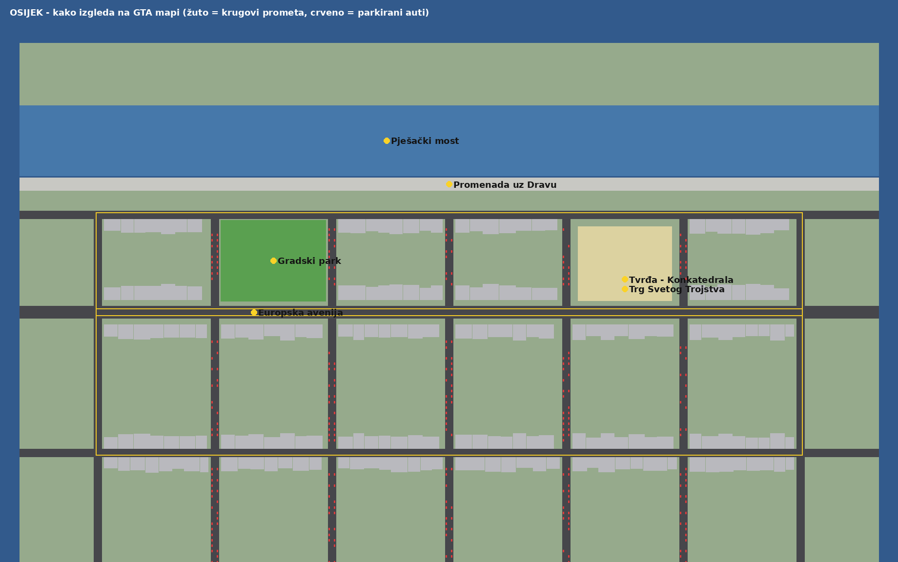
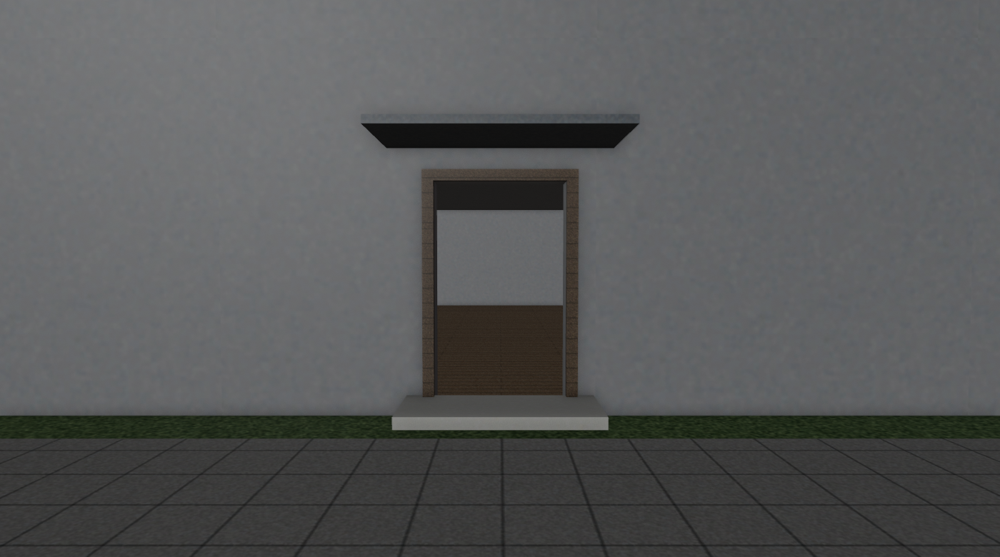
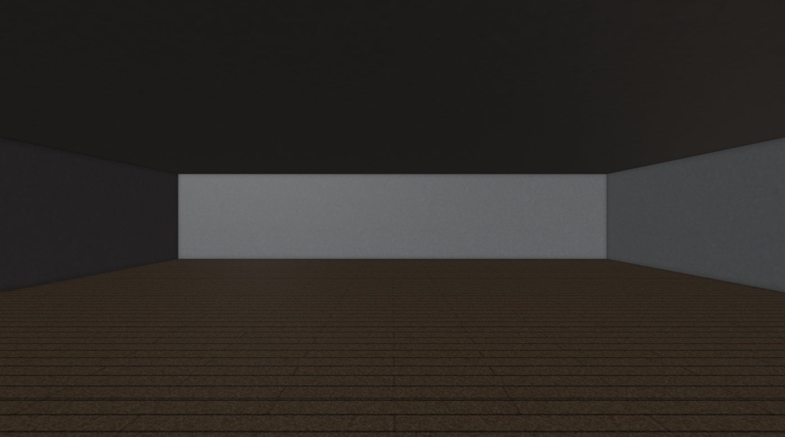
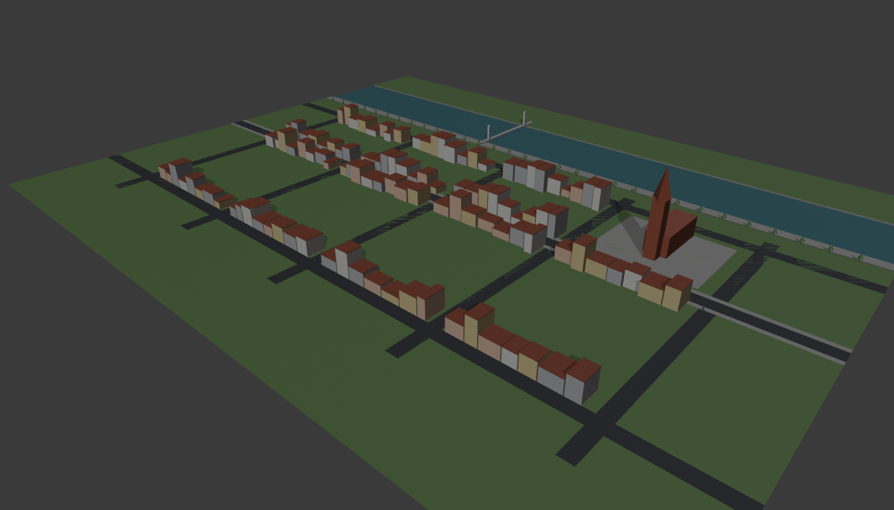
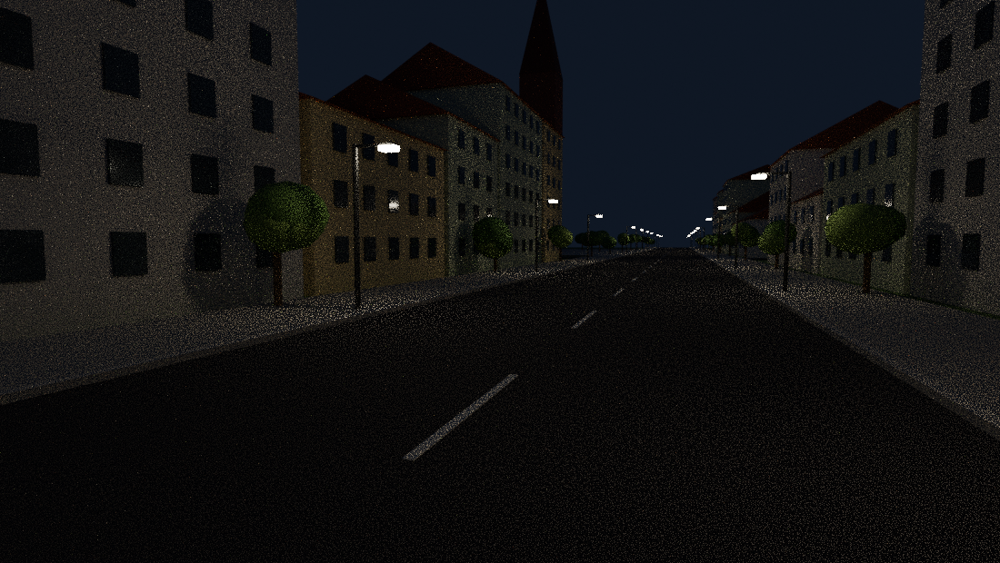
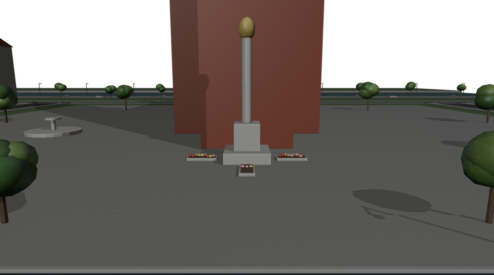

<p align="center"></p>

# OSRP Launcher — V1

A free launcher for **OSRP (Osijek Roleplay)**, a GTA V server (it runs on FiveM).
It uses the player's **own installed GTA V** (`GTA5.exe`). Players have to own a legal copy of the game.

> **Version:** 1.0.22 (V1). Stays at V1 until V2 is approved.

## What V1 does

- **Its own startup loading window** (OSRP logo + real checks: settings, finding GTA V, server status)
- **OSRP logo** everywhere: app icon, installer, title bar, sidebar, in-game loading screen
- **Own OSRP accounts**: players register and log in with an OSRP username and password, stored on your own server (`osrp_accounts`)
- **Ownership check**: the player has to confirm they own GTA V before going further
- **Store links** for players without the game: Steam, Epic Games, Rockstar
- **Finds GTA V automatically** (registry, Steam libraries, common folders), or the player can pick `GTA5.exe` by hand
- Checks that the file really is `GTA5.exe` / `GTA5_Enhanced.exe`
- **PLAY** installs the multiplayer client by itself (one time, after the player accepts the Cfx.re license) and connects straight to OSRP. Players never have to visit fivem.net
- **Singleplayer** starts GTA V through Steam, Epic or the Rockstar Launcher
- Shows whether the server is online and how many players are on
- News cards and a Discord link (set in `launcher/config.json`)

## Folders

```
launcher/              Electron app (Windows)
  config.json          server IP, Discord, news  <- edit this
  main.js              game detection + launching
  renderer/            UI (HTML/CSS/JS)
fivem-resources/
  osrp_core/           map name "Osijek", OSRP pause menu, keeps the GTA V HUD, stream/ for your map
  osrp_loading/        in-game loading screen with the OSRP logo
  osrp_framework/      own roleplay framework (characters, money, jobs, /me /do, admin)
  osrp_accounts/       own account system for the launcher (register / login)
  osrp_map/            in-game map builder with real GTA V props (street lights, trees, benches)
  osrp_osijek/         the custom Osijek city in-game (35 chunks, placed in the sea east of Los Santos, /osijek)
server/                setup-server.bat + start-server.bat (own test server on your PC)
branding/              OSRP logo (svg + png)
.github/workflows/     builds the .exe automatically on GitHub
```

## Start your own OSRP test server (Windows, free)
1. Download this repo (green **Code** button → *Download ZIP*) and unzip it.
2. Open the `server` folder and double-click **`setup-server.bat`**. It:
   - downloads the official server (FXServer) and the base resources
   - copies all OSRP resources into the server
   - asks for your **free server key** from [portal.cfx.re](https://portal.cfx.re) (Server Keys → Generate; use `127.0.0.1` for testing)
3. Double-click **`start-server.bat`**. Wait until the console shows the server started.
4. In the **OSRP Launcher**, go to *Postavke → Server adresa*, enter `127.0.0.1:30120`, *Spremi*, then **IGRAJ**.
5. The first time you join, the console prints an `add_principal ...` line with your license. Paste it into `server/OSRP-Server/server-data/server.cfg` and restart the server. That makes you admin.

Friends can join through the launcher with your public IP (`your.ip:30120`) once you open **port 30120 (TCP + UDP)** on your router and allow it in the Windows firewall.

## Keep OSRP online 24/7

### Option A: your own PC (free)
- `start-server.bat` restarts the server by itself if it ever crashes.
- Run **`install-autostart.bat`** once and the server starts automatically every time Windows starts (`remove-autostart.bat` turns that off).
- It's only online while your PC is on. In Windows power settings, set *Sleep → Never*.
- Friends join via your public IP: open **port 30120 TCP + UDP** on your router.

### Option B: Linux VPS (real 24/7, the PC can be off)
Needs an **x86_64 (Intel/AMD)** VPS with Ubuntu 22.04/24.04 or Debian 12, 4 GB RAM or more.
ARM servers (like the Oracle free tier) **don't work**, because FXServer only runs on x86_64.

Connect to the VPS over SSH and run **one command**:
```bash
curl -fsSL https://raw.githubusercontent.com/jakov543/Osrp/main/server/linux/install-osrp.sh | sudo bash
```
It installs everything, asks for your Cfx.re key, and sets OSRP up as a system service: it **starts on boot and restarts itself if it crashes**. At the end it prints the address to enter in the launcher.

| | Command |
|---|---|
| Console / logs | `journalctl -u osrp -f` |
| Restart | `sudo systemctl restart osrp` |
| Update OSRP from GitHub | `sudo bash /opt/osrp/repo/server/linux/install-osrp.sh update` |

## OSRP framework (own, no ESX/QBCore)
| What | How |
|---|---|
| Character creator | first join: first name, last name, date of birth, gender |
| Spawn / save | spawn point in `osrp_framework/config.lua`; position saved every 60 s |
| Money | cash + bank, HUD at top right, `/novac`, `/daj [id] [amount]` |
| Jobs + salary | Unemployed, Police, EMS, Mechanic, Taxi; pay every 10 min |
| Death | respawn at the hospital after 15 s (`E`) |
| Roleplay | `/me`, `/do` (3D text + chat, players nearby only) |
| Admin | `/car [model]`, `/dv`, `/tpm`, `/revive [id]`, `/setjob [id] [job]`, `/givemoney [id] [cash/bank] [amount]`, `/resetlik [id]` |

For other scripts: `exports.osrp_framework:GetPlayer(src)`, `AddMoney(src, 'cash', 100)`, `RemoveMoney(...)`, `SetJob(src, 'police')`.
No database needed for V1 (data is stored with FiveM KVP).

## Setup

### 1. Server
Easiest: use `server/setup-server.bat` (above). By hand: copy `fivem-resources/osrp_core`, `osrp_loading` and `osrp_framework` into your server's `resources/` folder and add to `server.cfg`:
```
ensure osrp_loading
ensure osrp_core
ensure osrp_framework
ensure osrp_accounts
ensure osrp_map
sets mapname "Osijek"
```

### 2. Launcher
Set your server IP in `launcher/config.json`:
```json
"serverAddress": "YOUR.IP:30120"
```

Run it locally:
```
cd launcher
npm install
npm start
```

Build the installer (.exe):
```
npm run dist
```
The installer ends up in `launcher/dist/`.

### 3. GitHub (free)
```
git remote add origin https://github.com/jakov543/Osrp.git
git push -u origin main
git tag v1.0.22
git push origin v1.0.22
```
GitHub Actions builds the Windows installer and puts it on the **Releases** page.

## OSRP accounts (own login)
- The `osrp_accounts` resource runs on your FiveM server. The launcher talks to it at `http://SERVER_IP:30120/osrp_accounts/...`.
- Register / log in in the launcher. The login is remembered for 30 days.
- Passwords are stored hashed (scrypt + salt), never as plain text. Brute-force protection: 8 wrong tries means a 10-minute wait, and at most 3 new accounts per IP per hour.
- Add `ensure osrp_accounts` to `server.cfg` (already in the template).
- Note: the connection to the server is plain HTTP, so tell players not to reuse a password from other sites.

## Build the city in-game with GTA V props (`osrp_map`)
Admins place real GTA V props in-game. Everything is saved on the server and everyone sees it. GTA street lights light up at night by themselves.

| Command | What it does |
|---|---|
| `/prop lampa` | street light in front of you (`lampa2` = modern) |
| `/prop drvo` | random leafy tree (birch, maple, oak). `bor` = pine, `grm` = bush |
| `/prop klupa` / `/prop kanta` | bench / bin |
| `/prop prop_bench_09` | **any** GTA V prop by its name |
| `/proplinija lampa 10 25 2` | a row: 10 lamps, every 25 m, **on both sides** of where you face (a whole street in one command) |
| `/proplinija drvo 15 12` | an alley of 15 trees, every 12 m |
| **`/predlozak ulica 120 14`** | **a whole street**: stand in the MIDDLE of the road and look along it. Lamps on both sides, tree alley, benches, bins, bollards, a hydrant (120 m long, road 14 m wide) |
| **`/predlozak trg 18`** | **a square**: stand in the center. Fountain, ring of trees, benches facing the center, lamps, bushes |
| **`/predlozak park 40 60`** | **a park** 40×60 m: stand at the start of the path. Path lamps, benches, rows of trees, bushes |
| **`/predlozak promenada 150`** | **a promenade**: props on your LEFT (e.g. along water). Lamps, trees, benches |
| `/propobrisi` | delete the nearest placed prop (within 5 m) |
| `/propundo` | delete the last placed prop |
| `/propovi` | list of short names |

Short names are in `osrp_map/config.lua` and you can add your own. Props only appear within 250 m, so FPS stays high.

## The real Osijek in-game (`osrp_osijek`)
`map/blender/osijek_export_gta.py` converts the Blender city with **Sollumz** into GTA assets:
- 35 chunks of 100 m, each a drawable with embedded textures and collision
- `osijek.ytyp` with all archetypes

On Linux it writes CodeWalker XML. On Windows, with Sollumz plus PyMateria, it writes the native `.ydr` / `.ytyp` files directly.

**The finished files are already in `osrp_osijek/stream/`.** v1.0.9 has 36 models with real textures (asphalt, paving, grass, brick, roof tiles, plaster, water, stone, gravel, glass, wood), per-surface collision (tarmac, concrete paving, grass, gravel, brick, roof tile...), intersections open for cars, and 109 real GTA V trees placed by script. Converted with `tools/xml2gta` (CodeWalker.Core) and verified.

v1.0.10: **30 enterable houses**. Each has a doorway with a real **GTA V door** (door system, unlocked; `Config.DoorsLocked`), a wooden floor, **GTA V furniture** (sofa, table, chairs, TV, plants) and a warm ceiling light. Every other building got a front door, a step and a canopy.

v1.0.11 – **a living city**:
- bigger: 7 cross streets, 3 rows of blocks, 73 chunks, **80 enterable houses**
- Osijek is drawn on the **minimap and pause map** (roads, buildings, Drava, park, Tvrđa, landmarks)
- **always spawn in Osijek**: saved positions in Los Santos are ignored (`osrp_framework` `Config.CityRadius`)
- **parked cars** (269 spots), **stop signs, traffic lights**, **pedestrians** walking and sitting on benches, and **traffic** (cars with drivers driving loops)

These are local per player, like GTA's own ambient life. Settings are in `osrp_osijek/config.lua`.

v1.0.12 – **water, landmarks, HUD, logo**:
- the **Drava is real GTA water**: the city now sits 3 m above sea level (`Config.Origin` z = 3) and the river bed is open; stone quay walls go down into the water all around the city
- new **suspension footbridge** level with the banks (walkable, railings, cables) and a rebuilt **co-cathedral** (94 m spire, aisles, buttresses, apse, clock, rose window)
- facades got **cornices and stone bases**
- **cars no longer fly**: parked cars, traffic, peds and signs spawn only when the ground under them is loaded, and parked cars are no longer frozen in the air
- the map uses **GTA radar colours** (dark land, light roads, blue river)
- **new HUD** (`osrp_framework/client/hud.lua`): money and job card, street + zone + compass next to the minimap (real Osijek street names from `osrp_osijek/streets.lua`), speedometer with RPM, gear, fuel and engine
- **new OSRP logo** (shield with the cathedral and the Drava) in the launcher, installer icon, loading screen and HUD; sources in `branding/`
- the map export is ~30x faster (`tools/make_layout.py` writes `layout.lua`)

v1.0.13 – **textures and roads**:
- new texture generator `map/blender/osrp_textures.py`: seamless **1024 px textures with normal maps** (asphalt with aggregate and cracks, cobblestone on the Tvrđa square, paving slabs, granite curbs, brick, roof tiles, slate, stucco plaster, stone, grass, gravel, wood, cast iron)
- all textures live in **one shared `osijek_txd.ytd`** (before: every chunk embedded its own copies), so the map is sharper and still ~20 MB
- roads: double solid centre line, dashed lane lines and edge lines on Europska avenija, centre lines on the side streets, stop lines, manhole covers and drains
- sidewalks along all side streets (blocks moved back 3 m), trees in the courtyards
- **roads no longer vanish at the city edges**: long pieces are cut at the 100 m chunk lines (96 chunks), LOD distance 750 m
- `xml2gta verify` now checks that every texture a chunk uses exists in the shared .ytd

v1.0.14 – **hospital, ambulance, airport, random events**:
- the city grows south (to y = -780, 144 chunks): **KBC Osijek** hospital (6 floors, red cross, ambulance bays, helipad with an air ambulance on the roof) and **Zračna luka Osijek** (1 km runway with markings and edge lights, taxiway, apron with 3 parked jets, terminal, car park, control tower, 2 hangars with planes, access road). **Copacabana** beach on the north bank.
- **ambulance**: when you are down press **G** (or `/hitna`, `/112`). EMS players (job `ems`) get a 112 call with GPS and revive you with E (CPR, +$150). If nobody is on duty or nobody comes in 90 s, an **AI ambulance** drives from KBC Osijek along the streets with sirens, two paramedics do CPR and you are back up (bill $250). `/hitna` also works when you are only hurt. Treatment at the KBC reception (E, $100). EMS players take an ambulance at the hospital garage.
- **random events** around you (`osrp_osijek/events.lua`, `Config.Events`): a car hits you, traffic accident (AI ambulance + police come), broken-down car (help the driver, +$75), thief (catch him to get the wallet back + $50), dumpster fire (fire truck comes), police chase. Admins: `/dogadaj [name]`.
- street router for the AI vehicles (`OsijekRoute`), new HUD zones (KBC Osijek, Zračna luka, Copacabana)

v1.0.15 – **map, doors, sea, airport**:
- **real drawn map** instead of blip rectangles (`Config.MapMode = 'nui'`): inside Osijek the GTA radar is replaced by a drawn minimap of the city (rotates with the camera, GPS route along the streets, waypoint, landmarks, other players, health/armour bars). **F7 / `/karta`** opens the big map with street names: drag, zoom, click to set a waypoint, right click to remove it. Pictures are made by `tools/make_minimap.py`.
- **house entrances fixed**: room floor level with the sidewalk (no dip), taller and wider doorway (1.5 x 2.9 m), avenue sidewalks reach the houses, and the doors swing open by script when you walk up and close behind you (GTA's door system often refused to move script doors)
- **sea no longer washes over the city**: the city sits 8 m above the sea (`Config.Origin` z = 8) and the ocean around Osijek is calmed (`SetDeepOceanScaler`)
- **airport**: runway numbers 09/27, approach and threshold lights, blue taxiway lights, 3 jet bridges, 5 floodlight masts, OSIJEK signs (lit), terminal entrance canopy, cargo terminal, fuel tanks, airside fence, GTA airport props (stairs, baggage loaders, carts, cargo, radar)
- **KBC Osijek**: lit KBC OSIJEK name, emergency entrance HITNA with an ambulance canopy, ambulance garage with 3 doors and 2 more ambulances

v1.0.16 – **characters, arrival, interiors, HUD**:
- **multicharacter** (`Config.MaxCharacters = 3`): pick, create or delete characters on the Tvrđa square; your old character is moved into slot 1 automatically. `/odjava` goes back to the selection.
- **new identity creator**: name, date of birth, nationality, sex, height, face, skin, hair, hair colour, 4 outfits (`Config.Outfits`), live preview of the character and an ID card
- **spawn selection**: last location, airport (fly in), Europska avenija, Tvrđa, KBC Osijek (`Config.SpawnPoints`)
- **arrival cutscene**: new characters fly in over the sea and land at Zračna luka Osijek (3 cameras, letterbox, ENTER skips), then stand in the arrivals hall (`osrp_osijek/arrival.lua`)
- **map loads before you appear**: nearest chunks first, all models requested in parallel, loading screen with progress (`exports.osrp_osijek:LoadArea`)
- **enter KBC Osijek and the airport terminal**: hospital lobby (reception = treatment, benches, vending machines, staff) and the terminal hall (check-in desks, seats, departures board, staff), lit inside
- **drive the parked ambulances, fly the planes and the air ambulance**: press F next to one (`Config.TakeVehicles`)
- roads: driveways from Vukovarska into the hospital lot and the ambulance garage, service road from the airport car park to the apron
- **NPCs**: 44 around you, 25 models, many stand and do things (phone, coffee, smoking, map); they greet you in English when you walk up and you can talk to them with E (`Config.NpcGreetings`, `Config.NpcChat`)
- **street props**: benches, bins, hydrants, news stands, bike racks, phone booths, planters along the streets; trees sit on the real ground
- v1.0.17 fix: the loading screen no longer hangs at "Učitavanje Osijeka" (FiveM exports cannot wait across resources: osrp_framework now polls `exports.osrp_osijek:AreaProgress` and starts the plane cutscene with the `osrp_osijek:playArrival` event). Character menu position fixed (`Config.MenuPreview`: Tvrđa square, on the ground, cathedral behind you), Tvrđa spawn moved off the cathedral.
- v1.0.18: tiered stone **fountain** on the Tvrđa square with water jets (`Config.FountainParticle`); **6 stone staircases** from the quays down to the Drava and a **marina** (pontoon + finger piers) with 6 boats + 2 jet skis at the beach (F = take one); swimming in the Drava / sea: E brings you back onto the bank; **106 real GTA benches** (promenade, park, bus stops, streets, hospital) - E to sit, NPCs sit on them properly; **trees** placed exactly on the ground; darker, natural **grass** + bushes and grass clumps on the green areas
- v1.0.19: Drava stairs rebuilt (3.2 m wide, solid stone parapet on the water side, landing with bollards), railing along both quays (open at the stairs and the footbridge), marina rebuilt as a floating dock (deck on white floats, walkway from the landing, finger piers with cleats, lamps) with the boats lengthwise in their berths
- v1.0.20: red **bike paths** on both Drava banks (lines, bike symbols), new **Šetalište** on the left bank (walkway, trees, lamps, benches looking at the river, path from the footbridge) to the Copacabana beach, 4 **bike rental** stations (cruiser, scorcher, BMX, tribike - F to take), **NPC cyclists** (`Config.Cyclists`) and **joggers** on the promenades, **64 pedestrians** that now appear near you, **real 3D grass** (GTA procedural grass on the lawns, the park and the beach) + calmer grass texture
- v1.0.21: **house interiors** - every enterable house is a furnished ground-floor flat: living room (sofa, armchair, coffee table, rug, TV on a media unit, dining table + 4 chairs, shelf, floor lamp, plants, wall art), kitchen (fridge, cooker, sink unit, cabinets, table + stools), bathroom (toilet, washbasin, bathtub, towel shelf), bedroom (double bed, bedside tables + lamps, wardrobe, dresser, rug); interior walls with doorways, tiled kitchen/bathroom, white ceiling, plaster inside, a light in every room. All prop names checked against the full GTA V object list (DurtyFree gta-v-data-dumps). Sit on sofas/armchairs/chairs/stools and lie on the bed with E. `Config.FurnitureTurn` turns a kind if it stands the wrong way.
- v1.0.22: **own props made in Blender** (`map/blender/osrp_props.py`, 46 models `osrpprop_*`): all flat furniture (sofa, beds, kitchen, bathroom...), hospital beds / curtains / cabinets / waiting chairs, airport check-in kiosks, gate seats, departure boards, baggage carousels, luggage carts, tugs, planters; **automatic sliding glass doors** (hospital lobby, emergency entrance, terminal); new **emergency hall** in the hospital (5 treatment bays); **beach rebuilt** - the sand runs down into the Drava, wooden pier with a 1 m board and a **3 m / 5 m diving tower**, lifeguard tower, volleyball court, showers, beach bar; **beach people** (sunbathers, swimmers, divers who climb the tower and jump); sidewalks/curbs now continuous where no street joins; darker grass
- **HUD**: custom notifications (colour codes work, success/error/warning), weapon HUD (name, clip / ammo), status row in the money card (health, armour, stamina, voice), server ID, players online and clock



| Entrance | Inside (furniture is added in-game) |
|---|---|
|  |  |
Add `ensure osrp_osijek`. Players spawn in Osijek (`osrp_framework/config.lua`), and admins can use `/osijek` to teleport there.

## Osijek map in Blender
Starter city script and full guide: [`map/BLENDER-MAP.md`](map/BLENDER-MAP.md)



| Street | Night |
|---|---|
|  |  |

| Intersection | Tvrđa (Holy Trinity column) |
|---|---|
|  |  |

## Requirements for players
- Windows 10/11
- A legal copy of GTA V (Steam / Epic / Rockstar)
- Nothing else: the launcher installs the multiplayer client by itself

## Osijek map
`osrp_core` renames the map to **Osijek** (server list, pause menu, map labels).
To build actual Osijek streets and buildings, put `.ymap/.ydr/.ytd` files in `osrp_core/stream/`.
Free tools for that: **CodeWalker** and **Blender + Sollumz**.

## Legal
This project is not affiliated with Rockstar Games or Take-Two. GTA V is not included. Every player must buy the game.
